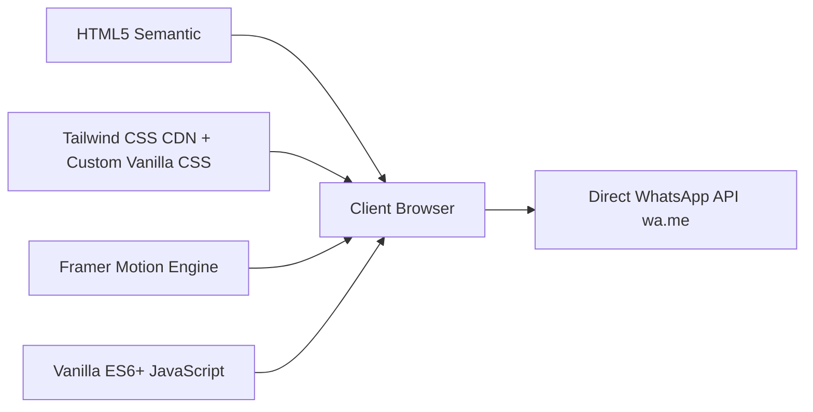

<div align="center">

# 🥗 sweetgreen Indonesia
### *Kuliner Sehat Pangan Organik Mitra Petani Lokal UMKM Nusantara*

[](https://github.com)
[](LICENSE)
[](https://github.com)
[](https://github.com)

<p align="center">
  <a href="#-tentang-proyek">Tentang</a> •
  <a href="#-fitur-utama">Fitur Utama</a> •
  <a href="#-desain-sistem--estetika">Desain Sistem</a> •
  <a href="#-tech-stack">Tech Stack</a> •
  <a href="#-arsitektur--struktur-direktori">Struktur File</a> •
  <a href="#-cara-instalasi--menjalankan">Panduan Instalasi</a> •
  <a href="#-konfigurasi-whatsapp">Integrasi WhatsApp</a> •
  <a href="#-lisensi">Lisensi</a>
</p>

---

</div>

## 🌿 Tentang Proyek

**sweetgreen Indonesia** adalah platform web kuliner sehat modern bertema *luxury farm-to-table* yang dirancang khusus untuk memberdayakan ekosistem **UMKM pangan lokal dan kelompok tani organik nusantara** (Lembang, Malang, Cilembu, Gunung Kidul, dll).

Proyek ini menghadirkan pengalaman visual kelas dunia dengan mengadaptasi filosofi estetika khas Sweetgreen (*"farm-stand chalkboard at golden hour"*) yang dipadukan dengan kemudahan transaksi bagi pasar Indonesia: **pemesanan instan tanpa hambatan registrasi melalui integrasi otomatis WhatsApp Dapur**.

> 💡 **Core Philosophy:** *Makan sehat tidak harus kaku. Makanan segar organik dari petani lokal disajikan dengan tipografi berwibawa, fotografi makanan hangat resolusi tinggi, tata letak bebas distraksi (zero-clutter), dan alur transaksi yang ramah pengguna.*

---

## ✨ Fitur Utama

### 1. 🎯 Navigasi Minimalis & Bersih (*Zero-Clutter Header*)
- **Navigasi Satu Baris:** Tautan kategori terstruktur rapi tanpa emoji berlebih dan tanpa wrapping baris (`MENU KAMI`, `KEUNGGULAN`, `MISI UMKM`, `KATERING`).
- **Wordmark Murni:** Logo otentik `sweetgreen` berwarna *Deep Forest* (`#00473c`) tanpa ornamen berlebihan.
- **Status Gerai yang Tenang:** Baris informasi gerai aktif dengan indikator statis hijau (bebas dari animasi kedip berlebih / radar loop yang mengganggu).

### 2. 🍲 Sistem Kustomisasi Menu Pop-up Sempurna (*Customizer Dialog*)
- **Layout Presisi di Tengah (*Dead-Center Viewport*):** Bebas dari bug pergeseran posisi berkat arsitektur *flexbox overlay* independen.
- **Pinned Header & Sticky Action Bar:** Judul menu, harga dasar, serta tombol aksi *"Tambahkan ke Tas"* dan *"Pesan Langsung via WhatsApp"* terkunci di atas dan bawah — **tidak pernah terpotong di layar mana pun**.
- **Scrollbar Halus Tipis (6px):** Scrollbar khusus bernuansa *Deep Forest* yang elegan, menggantikan scrollbar abu-abu tebal bawaan sistem operasi.
- **Segmented Control Takaran Saus:** Pilihan dressing interaktif (`Sedikit`, `Sedang (Standar)`, `Banyak`, `Dipisah`).
- **Kartu Topping Ekstra Organik:** Checkbox kustom dengan transparansi asal bahan lokal (misal: *Alpukat Mentega Lembang*, *Keju Kambing Artisan Jogja*).
- **Kalkulasi Harga Dinamis Real-Time:** Total harga ter-update otomatis saat pelanggan menambah atau menghapus topping ekstra.

### 3. 💬 Integrasi WhatsApp Dapur Lengkap (*End-to-End Direct Ordering*)
Setiap aksi pembelian langsung merangkum format chat terstruktur siap kirim ke admin dapur WhatsApp:
- **Pesan Instan per Menu:** Tombol cepat *"💬 Pesan WA"* di setiap kartu makanan.
- **Kustomisasi via WhatsApp:** Kirim pesanan dengan rincian saus dan ekstra topping pilihan.
- **Checkout Tas Belanja Otomatis:** Rangkuman rapi mencakup daftar item, kuantitas, catatan saus, pajak restoran PB1 (10%), total pembayaran, dan titik dapur penjemputan.
- **Konsultasi Katering Grup:** Form pesanan skala besar untuk kantor, resepsi, dan acara komunitas.
- **Floating Action WhatsApp:** Tombol melayang di pojok kanan bawah untuk bantuan cepat pelanggan.

### 4. 🏬 Jaringan Multi-Gerai Dapur UMKM Terdekat
Modal ganti gerai interaktif yang terhubung ke titik-titik dapur aktif:
- 📍 **Dapur UMKM Senopati, Jakarta Selatan** *(Dapur Pusat • 15 Mnt Siap)*
- 📍 **Dapur UMKM Kemang, Jakarta Selatan** *(Buka Sampai Malam • 12 Mnt Siap)*
- 📍 **Gerai UMKM Dago, Bandung** *(Sayur Organik Lembang • 18 Mnt Siap)*
- 📍 **Dapur UMKM BSD City, Tangerang** *(Pengiriman Cepat • 15 Mnt Siap)*

### 5. 📊 Transparansi Nutrisi & Makro per Porsi
Setiap hidangan dilengkapi dengan kartu nutrisi visual:
- ⚡ **Kalori** (kkal)
- 💪 **Protein** (gram)
- 🌾 **Karbohidrat Kompleks** (gram)
- 🥗 **Serat Pangan Nabati** (gram)

---

## 🎨 Desain Sistem & Estetika

Website ini mengadopsi standar identitas visual premium berbasis token warna Sweetgreen:

| Token | Warna | Hex Code | Peran Desain |
| :--- | :---: | :---: | :--- |
| **Cream Canvas** |  | `#f4f3e7` | Latar belakang utama (hangat, organik, alami) |
| **Deep Forest** |  | `#00473c` | Warna jangkar struktural, teks primer, button outline |
| **Lime Glow** |  | `#e6ff55` | Aksi berenergi tinggi, badge counter, primary CTA |
| **Sage Mist** |  | `#d8e5d6` | Aksen sekunder, latar kartu, pembatas lembut |
| **Warm Sand** |  | `#e8dcc6` | Highlight banner, strip statistik mitra |
| **Forest Shadow**|  | `#0e150e` | Tipografi headline tajam & kontras tinggi |
| **WhatsApp Green**|  | `#25d366` | Aksen komunikasi langsung & tombol WhatsApp |

### 🖋️ Tipografi
- **Headline & Branding:** `Plus Jakarta Sans` / `Outfit` (700 Bold & 400 Regular, tight letter-spacing).
- **Body & Teks Fungsional:** `Plus Jakarta Sans` / `Inter` (readable, 13–15px, 1.5 line-height).

---

## 🛠️ Tech Stack



- **Frontend Core:** HTML5 Semantic, Modern Vanilla JavaScript (ES6+ Modules & State Management)
- **Styling Architecture:** Custom CSS Design Tokens + Tailwind CSS CDN Utility Framework
- **Animation Engine:** Framer Motion (`motion@11.11.13`) untuk transisi pegas (*spring physics*), *staggered entrance*, dan *fade elevation*
- **Typography:** Google Fonts (`Plus Jakarta Sans`, `Outfit`, `Inter`)
- **Assets & Fotografi:** Fotografi kuliner resolusi tinggi dengan kompresi web optimal
- **Dev Server:** Node.js HTTP Server (`dev-server.js`) atau Python 3 (`http.server`)
- **Deployment Platform:** Vercel (Edge CDN Static Hosting)

---

## 📁 Arsitektur & Struktur Direktori

```
sweetgreen/
├── index.html              # Markup semantik utama, Tailwind config, & template modal
├── style.css               # Desain sistem, variabel warna HSL/Hex, modal overlay, & media queries
├── app.js                  # Logika katalog menu, modal kustomisasi, tas belanja, & generator WhatsApp
├── dev-server.js           # Zero-dependency local development server (Node.js)
├── vercel.json             # Konfigurasi deploy Vercel Edge Static Site
├── package.json            # Script manajemen npm & metadata proyek
├── README.md               # Dokumentasi profesional proyek
├── LICENSE                 # Lisensi MIT Open Source
└── images/                 # Aset fotografi makanan resolusi tinggi
    ├── hero-bowl.jpg           # Warm Harvest Bowl hero banner
    ├── harvest-bowl.jpg        # Foto menu Warm Harvest Bowl
    ├── crispy-rice-bowl.jpg    # Foto menu Crispy Rice Bowl
    ├── guacamole-greens.jpg    # Foto menu Guacamole Greens
    ├── kale-caesar.jpg         # Foto menu Kale Caesar Salad
    ├── peach-burrata.jpg       # Foto menu Peach & Goat Cheese Bowl
    ├── shroomami-bowl.jpg      # Foto menu Shroomami Warm Bowl
    ├── hummus-focaccia.jpg     # Foto menu Hummus & Focaccia Sides
    ├── farm-harvest.jpg        # Banner cerita kemitraan petani lokal
    └── catering-spread.jpg     # Foto hamparan katering acara besar
```

---

## 🚀 Cara Instalasi & Menjalankan

### Prasyarat
- Peramban web modern (Google Chrome, Mozilla Firefox, Safari, Microsoft Edge).
- *Opsional:* Node.js (v14+) atau Python (v3+) untuk menjalankan local development server.

### 1. Kloning Repositori
```bash
git clone https://github.com/username/sweetgreen-indonesia.git
cd sweetgreen-indonesia
```

### 2. Jalankan Dev Server

Pilih salah satu cara di bawah ini:

#### Opsi A: Menggunakan Node.js (Rekomendasi)
```bash
npm run dev
# atau langsung:
node dev-server.js
```

#### Opsi B: Menggunakan Python 3
```bash
python3 -m http.server 5173
```

#### Opsi C: Menggunakan Ekstensi VS Code
Cukup klik kanan pada `index.html` dan pilih **Open with Live Server**.

### 3. Akses Website
Buka browser dan kunjungi:
👉 **`http://localhost:5173`** (atau port yang ditampilkan di terminal).

---

## ⚙️ Konfigurasi WhatsApp

Nomor WhatsApp tujuan untuk pesanan dan customer support dapat dikonfigurasi pada baris teratas file [`app.js`](app.js):

```javascript
// Konfigurasi Nomor WhatsApp Dapur Sweetgreen Indonesia
// Format: kode negara tanpa tanda '+' (contoh: 6281298765432)
const WHATSAPP_PHONE = '6281298765432';
```

### Format Pesan Otomatis WhatsApp yang Dihasilkan
Ketika pelanggan menekan tombol **Checkout**, sistem akan memformat chat yang rapi dan terstruktur:

```text
Halo Dapur Sweetgreen Indonesia! Saya ingin memesan:

- 1x Warm Harvest Bowl
  * Saus: Sedang (Standar)
  * Topping: Ekstra Alpukat Mentega
  * Harga: Rp 56.000

- 2x Crispy Rice Bowl
  * Saus: Dipisah
  * Harga: Rp 96.000

-----------------------------
Subtotal: Rp 152.000
PB1 (10%): Rp 15.200
Total Pembayaran: Rp 167.200
Lokasi Dapur: Dapur UMKM Senopati, Jaksel
Metode: Ambil Sendiri di Gerai

Mohon konfirmasi ketersediaan dan nomor rekening/QRIS untuk pembayaran. Terima kasih!
```

---

## 📱 Responsivitas & Aksesibilitas (A11y)

- **Mobile First & Desktop Perfect:** Tampilan otomatis menyesuaikan dari layar smartphone (360px) hingga layar monitor ultra-wide (1920px+).
- **ARIA Standards:** Modal dialog dilengkapi `role="dialog"`, `aria-modal="true"`, dan `aria-labelledby` untuk keterbacaan screen reader.
- **Keyboard Navigation:** Mendukung tombol <kbd>Esc</kbd> untuk menutup modal secara instan dan navigasi fokus tab yang runut.

---

## 🤝 Panduan Kontribusi

Kontribusi untuk kemajuan ekosistem kuliner UMKM nusantara sangat terbuka!

1. **Fork** repositori ini
2. Buat branch fitur baru (`git checkout -b fitur/FiturKeren`)
3. Commit perubahan Anda (`git commit -m 'Menambahkan fitur visual baru'`)
4. Push ke branch Anda (`git push origin fitur/FiturKeren`)
5. Buka **Pull Request**

---

## 📄 Lisensi

Didistribusikan di bawah Lisensi **MIT**. Lihat file `LICENSE` untuk informasi selengkapnya.

---

<div align="center">
  <sub>Dibuat dengan ❤️ dan dedikasi untuk memajukan produk petani lokal & kuliner sehat UMKM Nusantara.</sub>
  <br />
  <strong>sweetgreen Indonesia © 2026. All rights reserved.</strong>
</div>
